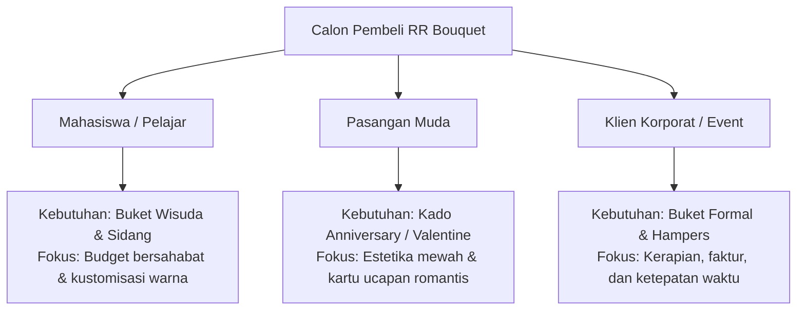
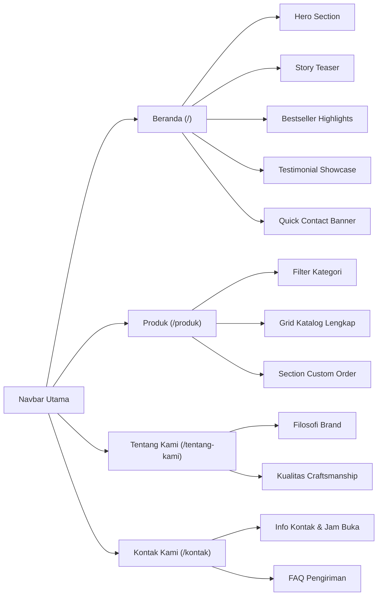
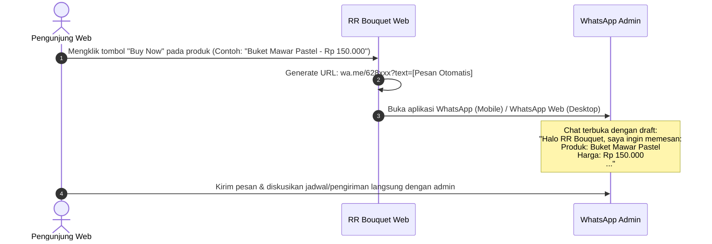
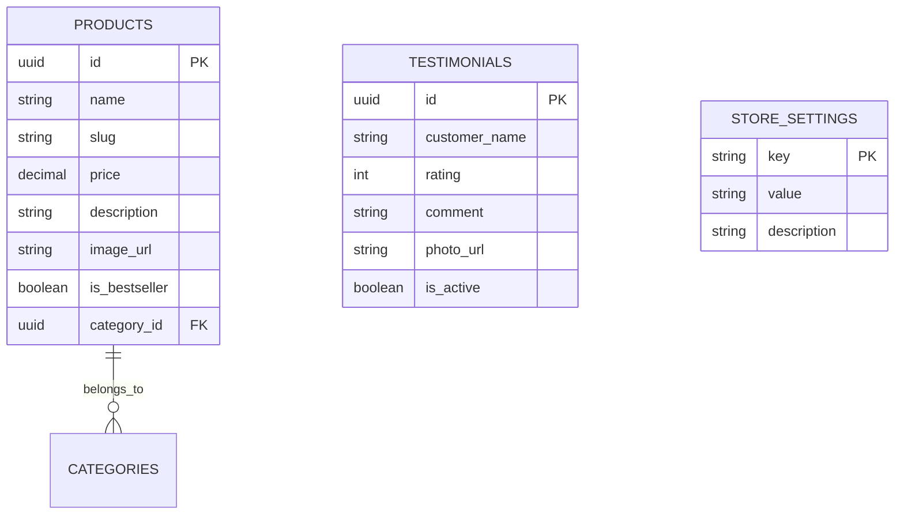
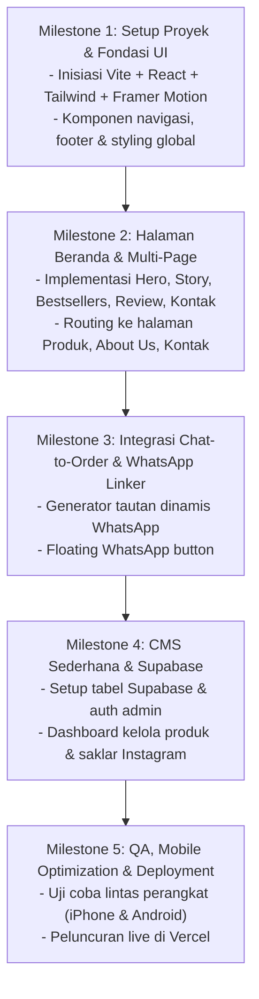

# Product Requirement Document (PRD)
## RR Bouquet — Interactive Company Profile & Catalog Website

| Metadata | Keterangan |
| :--- | :--- |
| **Nama Produk** | RR Bouquet Web Profile & Interactive Catalog |
| **Versi Dokumen** | v1.0 |
| **Status** | Approved for Development |
| **Peran Penulis** | Senior Product Manager |
| **Tech Stack** | React (Vite) + Framer Motion + Tailwind CSS + Supabase |
| **Deployment Target** | Vercel (Frontend) + Supabase Cloud (Backend/DB/Storage) |

---

## 1. Executive Summary & Visi Produk

### 1.1 Visi Produk
> *"Setiap Buket Punya Cerita, Setiap Hadiah Punya Makna."*

Menghadirkan website profil perusahaan yang elegan, interaktif, dan ramah pengguna bagi **RR Bouquet** untuk memperkuat identitas brand, memamerkan keindahan karya buket, serta menyederhanakan alur konversi dari calon pembeli menjadi transaksi melalui WhatsApp (*Chat-to-Order*).

### 1.2 Masalah yang Diselesaikan (Problem Statement)
* **Keterbatasan Etalase Media Sosial:** Instagram sering kali membuat katalog produk tercecer di berbagai postingan dan sorotan, menyulitkan calon pembeli membandingkan model buket dan harga secara cepat.
* **Friksi Transaksi E-Commerce:** Pembelian buket adalah transaksi yang sangat personal (memerlukan kustomisasi warna kertas, kartu ucapan, dan tanggal pengiriman). Sistem checkout e-commerce konvensional terlalu kaku dan menimbulkan *cart abandonment*.
* **Kebutuhan Aksesibilitas Mobile:** Mayoritas audiens (mahasiswa dan pasangan muda) mengakses via smartphone; website harus berbobot ringan, beranimasi lembut, dan nyaman dioperasikan satu tangan.

---

## 2. Target Pengguna & Persona



| Tipe Pengguna | Karakteristik & Kebutuhan Utama | Ekspektasi UX |
| :--- | :--- | :--- |
| **Mahasiswa / Pelajar** | Sensitif terhadap harga, mencari buket untuk wisuda, sidang, atau sempro teman. | Melihat harga dengan transparan, filter kategori buket wisuda, dan opsi *custom budget*. |
| **Pasangan Muda** | Mengutamakan estetika visual, mencari kado ulang tahun atau *anniversary*. | Gambar produk beresolusi tinggi, transisi animasi halus, dan kemudahan memesan kartu ucapan khusus. |
| **Korporat / Event** | Membutuhkan buket meja/tangan untuk apresiasi pembicara, pimpinan, atau hampers kantor. | Halaman *About Us* yang profesional, testimoni terpercaya, dan jalur kontak langsung yang responsif. |
| **Pemilik Toko (Admin)** | Mengelola katalog harian tanpa keahlian teknis pemrograman. | CMS sederhana untuk memperbarui stok/harga, menambah foto buket, dan mengatur testimoni. |

---

## 3. Arsitektur Informasi & Navigasi (Multi-Page)

Website dirancang dengan struktur *multi-page* terorganisir untuk menjaga kebersihan visual dan kemudahan navigasi:



---

## 4. Spesifikasi Fungsional Halaman

### 4.1 Halaman Beranda (`/`)
Berdasarkan wireframe prototype yang telah disesuaikan:
* **Header / Navbar:**
  * Logo RR Bouquet (kiri).
  * Menu navigasi: `BERANDA`, `PRODUK`, `ABOUT US`, `KONTAK KAMI`.
  * CTA Button: `Pesan Sekarang` (mengarahkan ke WhatsApp umum).
  * *Mobile View:* Hamburger menu dengan transisi geser mulus (*Framer Motion*).
* **Hero Section:**
  * Visual banner utama dengan tipografi elegan dan pesan penyambutan.
  * Tombol aksi ganda: `Lihat Katalog` (ke halaman Produk) dan `Konsultasi Buket` (ke WhatsApp).
* **Brand Story Section:**
  * Menampilkan headline: *"Buket Spesial untuk Momen Istimewa"*.
  * Tagline: *"Setiap Buket Punya Cerita, Setiap Hadiah Punya Makna."*
  * Komposisi tumpuk 3 foto visual karya buket dengan efek *staggered parallax animation*.
  * Teks deskripsi pengantar tentang ketelitian pembuatan buket RR Bouquet.
* **Our Bestsellers Preview:**
  * Menampilkan 4 produk terpopuler dengan kartu produk (Foto, Judul, Label Harga `Rp ...`).
  * Setiap kartu memiliki tombol **"Buy Now"** yang memicu *Chat-to-Order*.
  * Tombol sekunder di bawah: `Lihat Semua Produk` (mengarahkan ke `/produk`).
* **Testimoni Pelanggan (Social Proof):**
  * Judul: *"Apa kata pelanggan kami tentang kami"*.
  * Slider carousel interaktif (bisa digeser / di-*swipe* di HP, lengkap dengan tombol panah navigasi).
  * Menampilkan foto buket asli, nama pelanggan, bintang rating (5 bintang), dan kutipan kepuasan.
* **Kontak Cepat & Footer:**
  * Section penutup: *"Hubungi kami jika Anda memiliki pertanyaan"* dengan tombol `Hubungi Admin`.
  * Footer: Logo RR Bouquet, Hak Cipta © 2026, tautan Kebijakan & Ketentuan.

> [!NOTE]
> **Penyesuaian Wireframe:** Sesuai kesepakatan produk, section *Banner Diskon 15%* resmi ditiadakan dari halaman beranda agar tampilan lebih bersih, premium, dan fokus pada keindahan produk.

---

### 4.2 Halaman Katalog Produk (`/produk`)
* **Filter Kategori Dinamis:**
  * Tombol filter instan tanpa reload: `Semua`, `Buket Wisuda & Sidang`, `Buket Romantis / Anniversary`, `Buket Snack / Uang`, `Kebutuhan Event`.
* **Product Card & Modal Detail:**
  * Kartu produk interaktif: *hover zoom effect* pada gambar, badge kategori, dan harga.
  * Modal/Pop-up Detail Cepat: Ketika kartu diklik, muncul informasi ukuran buket, jenis bahan, dan saran pemesanan.
* **Section "Custom Order":**
  * Kartu promosi khusus buket kustom: *"Punya Ide Buket Sendiri atau Mau Menyesuaikan Budget?"*
  * Tombol CTA: `Request Buket Kustom via WhatsApp` yang otomatis membuka chat dengan format pemesanan kustom.

---

### 4.3 Halaman Tentang Kami (`/tentang-kami`)
* **Narasi Brand:** Perjalanan dan dedikasi RR Bouquet dalam menghadirkan rangkaian berkualitas tinggi.
* **Nilai Keunggulan (*Value Proposition*):**
  1. *Bunga Berkualitas:* Pemilihan bunga segar dan artificial grade terbaik.
  2. *Wrapping Eksklusif:* Bahan kertas pembungkus tahan air dengan teknik lipatan profesional.
  3. *Free Greeting Card:* Kartu ucapan gratis yang dipersonalisasi untuk setiap buket.

---

### 4.4 Halaman Kontak Kami (`/kontak`)
* **Informasi Operasional:** Jam kerja layanan admin WhatsApp, tautan profil Instagram, dan lokasi operasional.
* **FAQ Ringkas:** Menjelaskan cara pemesanan, kebijakan pemesanan H-1 / same-day (diskusikan via chat), dan metode koordinasi kurir.

---

### 4.5 Elemen Global: Sticky Floating WhatsApp Button
* Ikon WhatsApp mengambang di sudut kanan bawah layar yang selalu terlihat di seluruh halaman.
* Dilengkapi mikro-animasi denyut lembut (*pulse effect*) untuk menarik perhatian tanpa mengganggu pembacaan konten.
* Posisi disesuaikan agar tidak menutupi elemen penting di layar smartphone (*safe area mobile*).

---

## 5. Alur Mekanisme Chat-to-Order (WhatsApp Integration)

Setiap aksi pemesanan tidak melalui sistem *cart* konvensional, melainkan langsung menyusun tautan pesan WhatsApp terformat otomatis (*URI Encoded*):



### Format Pesan WhatsApp:
1. **Untuk Produk Bestseller/Katalog:**
   ```text
   Halo RR Bouquet, saya tertarik memesan produk berikut dari website:
   - Nama Produk: [Nama Produk]
   - Perkiraan Harga: [Rp ...]
   - Tautan Produk: [URL Halaman]

   Mohon info ketersediaan slot dan jadwal pengirimannya. Terima kasih!
   ```
2. **Untuk Custom Order:**
   ```text
   Halo RR Bouquet, saya ingin konsultasi pemesanan buket kustom:
   - Acara/Momen: (Wisuda / Anniversary / Ulang Tahun / Lainnya)
   - Target Budget: Rp ...
   - Tema Warna / Catatan: ...

   Mohon bantuan rekomendasi desain dan ketersediaannya. Terima kasih!
   ```

---

## 6. Modul Manajemen Konten (CMS Sederhana)

Untuk memudahkan pemilik toko memperbarui konten secara mandiri tanpa menyentuh kode program:



### Fitur Utama Dashboard Admin:
1. **Manajemen Produk:**
   * Tambah, edit, hapus produk (nama, harga, kategori, deskripsi).
   * Unggah foto buket langsung ke Supabase Storage (otomatis kompresi gambar).
   * Tombol *Switch* untuk menandai produk sebagai **Bestseller** (agar tampil di Beranda).
2. **Manajemen Testimoni (Hybrid Module):**
   * Tambah/edit review pelanggan (nama, rating 1–5 bintang, ulasan teks, foto buket yang diterima).
   * **Toggle Switch Feed Instagram:** Saklar ON/OFF untuk mengaktifkan atau menonaktifkan tampilan widget Instagram Feed di halaman depan.
3. **Pengaturan Kontak:**
   * Ubah nomor WhatsApp tujuan tanpa perlu *redeploy* kode.

---

## 7. Kebutuhan Non-Fungsional (NFR)

* **Performa & Loading Speed:**
  * Waktu muat awal (*First Contentful Paint*) $< 1.2$ detik pada jaringan seluler 4G.
  * Optimasi format gambar otomatis ke WebP/AVIF dengan *lazy-loading*.
* **Interaktivitas & Estetika (Framer Motion):**
  * *Page transitions:* Transisi antar-halaman meluncur halus tanpa kedipan putih layar.
  * *Micro-interactions:* Tombol memberi respon sentuhan halus (*scale down 0.98* saat diklik).
  * *Scroll reveal:* Elemen teks dan gambar muncul bertahap (*fade-in + subtle slide-up*) saat di-scroll.
* **Mobile-First Responsiveness:**
  * Tata letak dioptimalkan untuk lebar layar mobile standar (360px – 430px) hingga layar desktop (1366px – 1920px).
* **SEO & Social Sharing:**
  * Konfigurasi metadata Open Graph (OG Tag) lengkap dengan gambar *preview* menarik saat tautan website dibagikan ke WhatsApp, Instagram Bio, atau Twitter/X.
* **Keamanan Admin:**
  * Halaman CMS dilindungi autentikasi email & kata sandi via Supabase Auth.

---

## 8. Arsitektur Teknis & Deployment

* **Frontend:** React (Vite) + Tailwind CSS + Framer Motion + Lucide React (ikon).
* **Routing:** React Router v6.
* **Backend & Database:** Supabase (PostgreSQL Database, Supabase Storage untuk foto buket, Supabase Auth untuk proteksi admin).
* **Deployment & Hosting:**
  * Frontend di-deploy via **Vercel** (koneksi otomatis dengan GitHub, SSL gratis, CDN global, $0 / bulan).
  * Backend di **Supabase Cloud** (Tier Gratis: Database 500 MB, Storage 1 GB permanen, tanpa *cold start*).

---

## 9. Rencana Implementasi & Milestone



---

Dokumen ini menjadi acuan tunggal (*single source of truth*) dalam perancangan antarmuka (UI/UX) dan pengembangan kode teknis website **RR Bouquet**.
